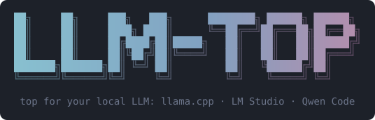
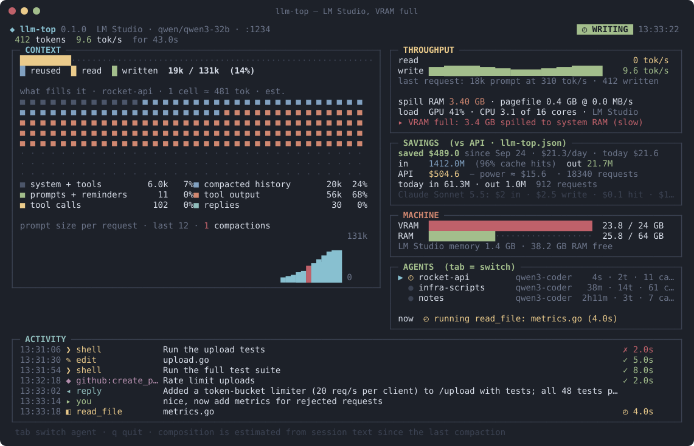
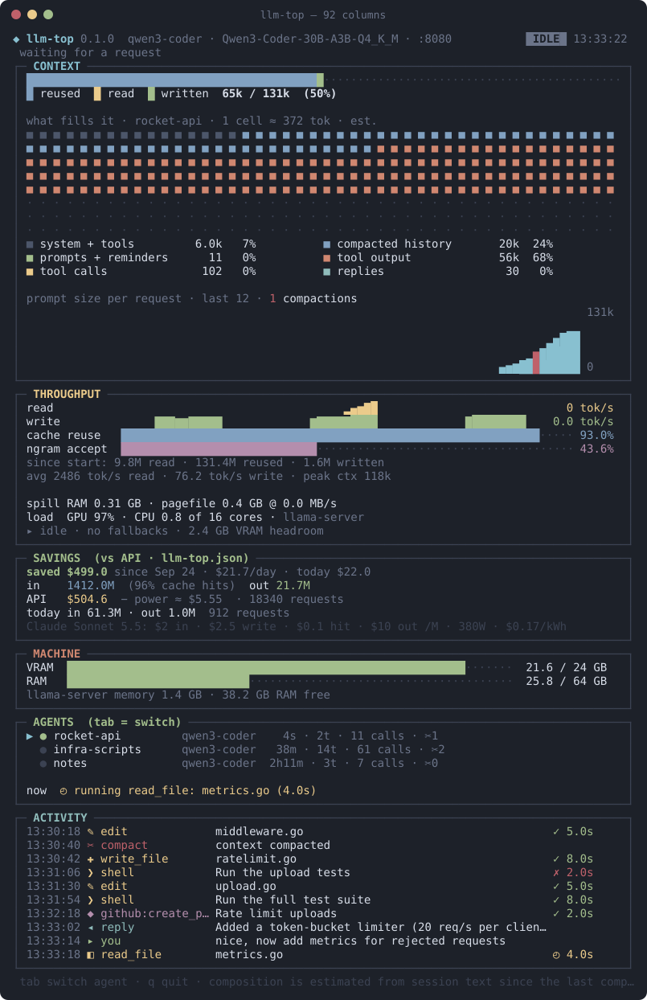

<p align="center">
  
</p>

<p align="center">
  <b><code>top</code> for your local LLM.</b><br>
  A live terminal dashboard for <a href="https://github.com/ggml-org/llama.cpp">llama.cpp</a>'s <code>llama-server</code>
  or <a href="https://lmstudio.ai">LM Studio</a>, and the <a href="https://github.com/QwenLM/qwen-code">Qwen Code</a> agents using it.
</p>

<p align="center">
  <a href="https://github.com/jdominick05/llm-top/actions/workflows/ci.yml"></a>
  <a href="https://github.com/jdominick05/llm-top/releases/latest"></a>
  
  
  <a href="LICENSE"></a>
</p>

<p align="center">
  
</p>

<p align="center"><sub>Demo data. The images are rendered from llm-top's own output, see <a href="#regenerating-the-images">below</a>.</sub></p>

## Why

- **See what the server is doing right now.** Prompt reading with progress and ETA, tokens written and their speed,
  cache reuse, all from the server itself.
- **See what fills the context.** An estimated breakdown of the selected agent session (system + tools, compacted
  history, prompts, tool output, tool calls, thinking, replies) and the prompt size of every request, compactions
  in red.
- **Find the bottleneck.** VRAM spilled into system RAM, paging, the CPU doing GPU work, or a server burning cores
  while idle, in one line.
- **Know what it saved you.** The same tokens at API prices, minus the GPU's electricity.
- **Zero setup, read-only.** It finds llama-server on `:8080` (or whatever port it listens on) or LM Studio on `:1234` by itself, sends nothing but
  GETs, and never touches your session logs. One static binary for Windows and Linux.

## Install

**Windows** (PowerShell)

```powershell
irm https://raw.githubusercontent.com/jdominick05/llm-top/main/install.ps1 | iex
```

**Linux** (x86-64)

```sh
curl -fsSL https://raw.githubusercontent.com/jdominick05/llm-top/main/install.sh | sh
```

Both scripts download the latest release, check it against `SHA256SUMS`, and install `llm-top`
(Windows: `%LOCALAPPDATA%\Programs\llm-top`, added to your PATH; Linux: `~/.local/bin`).

<details>
<summary>Options, manual install, uninstall</summary>

```powershell
.\install.ps1 -Version 0.2.0 -Dir C:\tools\llm-top -NoPath   # from a checkout: a version, a folder, no PATH change
```

```sh
sh install.sh 0.2.0                                         # a specific version
LLMTOP_BIN=/usr/local/bin sh install.sh                     # somewhere else
```

No account or token is needed; a `GITHUB_TOKEN` only raises GitHub's API rate limit. The archives and
`SHA256SUMS` are also on the [releases page](https://github.com/jdominick05/llm-top/releases) if you'd rather
install by hand.

**Uninstall:** Windows: delete `%LOCALAPPDATA%\Programs\llm-top` and remove it from your user PATH (Settings →
"Edit environment variables for your account"), and `%APPDATA%\llm-top` for the config. Linux:
`rm ~/.local/bin/llm-top` and `~/.config/llm-top`.

</details>

## Font

llm-top draws with box lines, blocks and symbols. It is made for **MesloLGS NF**, the font
[powerlevel10k recommends](https://github.com/romkatv/powerlevel10k#manual-font-installation), which has every
glyph it uses. Install the four `MesloLGS NF *.ttf` files from there and select the font in your terminal:

- **Windows Terminal:** Settings → your profile → Appearance → Font face → `MesloLGS NF`.
- **Linux:** copy the files to `~/.local/share/fonts`, run `fc-cache -f`, and pick `MesloLGS NF` in your terminal.

Other fonts work, but the terminal draws glyphs they lack from a fallback font, which can misalign the panels.
Cascadia Mono (Windows Terminal's default) lacks a few icons (`✂ ⌕ ✎ ✚ ☑ ✦ ★ ✗`); Consolas (the old console host)
lacks the bar-chart blocks too.

## Run

```sh
llm-top                       # tab / shift+tab: switch session · q, esc, ctrl+c: quit
llm-top -config my.json       # use another config file
llm-top -once 140 60          # print a single frame after ~7 s and exit (no TTY needed)
llm-top -version
```

## What's on screen

| Panel | Shows |
|---|---|
| **Header** | alias, model, address, and the state: `IDLE` `READING` `WRITING` `✂ COMPACTING` `BUSY` `LOADING` `SLEEP` `AUTH` `ROUTER` `NO MODEL` `DOWN` `HOLD` |
| **CONTEXT** | context window fill (reused / read / written), what fills it for the selected session (est.), prompt size per request |
| **THROUGHPUT** | read / write tok/s, cache reuse, speculative decoding (see below), totals since start, fallbacks and the bottleneck verdict |
| **SAVINGS** | API cost of the same tokens minus GPU electricity, all time and today |
| **MACHINE** | VRAM, RAM, the inference process's memory; on Windows with an NPU, its load and memory, and with AMD's `xrt-smi` its hardware contexts, commands/s and the processes holding them |
| **AGENTS** | Qwen Code sessions of the last 6 hours and what the selected one is doing |
| **ACTIVITY** | prompts, tool calls with duration and result, replies, compactions |

## Speculative decoding

With `--spec-type` (and `--metrics`) THROUGHPUT gets two rows, named after the drafter(s) in the slot's
`speculative.types` (`ngram-mod`, `dflash`, `dflash+ngram` for `draft-dflash,ngram-mod`; plain `draft` when
`/slots` is off or not read yet):

```
ngram-mod     ▄▅▆▇▇▇▆▆▅▄▃▂▁▁▁▁ 47.9% · 43.6% all
tok/draft      2.6 · 2.5 all  by pos ▇▇▆▆▅▅▅▄▄▄▃
```

The first row is the share of drafted tokens the model accepted: the sparkline per poll and the bright number
over the last 120 polls that drafted (about a minute when it drafts all the time; polls without drafts don't
count), then since server start (`all`). The second is accepted tokens per draft, recent and since start, and,
if there is room, the share of drafts accepted at each draft position since start. Both rows are hidden when the
server does not draft (no counters, or `speculative.types` is `none`).

## The bottleneck line

<p align="center">
  
</p>

The bottom of THROUGHPUT watches the process doing inference: `server_process`, LM Studio's engine, or else
whatever holds more than 1 GB of VRAM. A `?` after the name means it was guessed.

| Row | Meaning |
|---|---|
| **spill** | GPU memory living in system RAM: on Windows the process's shared GPU memory, which the driver fills with whatever doesn't fit in VRAM and which runs at PCIe speed (about 0.35 GB is normal); on Linux, amdgpu GTT. Then page file / swap in use and how fast memory is read back from disk. |
| **load** | GPU utilization of the process (Windows) or the card (Linux), and the CPU cores the process uses. |
| **▸ verdict** | the first that applies: **paging** (more than 2 MB/s read back from disk, or the process in swap) · **VRAM full** (more than 0.75 GB spilled) · **CPU-bound** (1.5+ cores while the GPU is under 50%: layers or KV cache on the CPU) · **GPU-bound (normal)**. When idle: **busy-wait** (a server burning cores without work, e.g. llama-server without `--poll 0`) or the VRAM headroom. |

## Servers

### llama-server

| Started with | What llm-top does |
|---|---|
| defaults | full view; `/slots` is only polled while a request runs (see below) |
| `--metrics` | adds totals, cache reuse, draft acceptance and real speeds for savings; lets llm-top skip `/slots` while idle |
| `--no-slots` | `BUSY` / `IDLE` from `/metrics` only, no live progress |
| `--api-key` / `--api-key-file` | set `api_key` in the config or `LLAMA_API_KEY`; `AUTH` when it is missing or wrong |
| `-np N` (several slots) | shows the busy slot (`slot id 2 · 4 slots, 2 busy`), throughput summed over all slots |
| `--sleep-idle-seconds` | `SLEEP`; never wakes the server (with `--metrics`, see below) |
| router mode (`--models-dir`, `--models-preset`) | watches `router_model` or the first loaded model; never asks about unloaded models, so it never triggers a load |
| `--host` / `--port` / another machine | `server_url` in the config |

> [!NOTE]
> Every `GET /slots` wakes a sleeping llama-server and resets its idle timer; `/health`, `/props`, `/models` and
> `/metrics` don't. With `--metrics`, llm-top watches `/metrics` and asks `/slots` only while something runs.
> Without it, `/slots` is the only live signal and is polled every 500 ms, which keeps a `--sleep-idle-seconds`
> server awake.

### LM Studio

LM Studio's API (`/api/v1/models`, LM Studio 0.4+) gives the loaded model and its context length. It has no live
progress, so llm-top also reads LM Studio's server log (`~/.lmstudio/server-logs`, read-only; only status lines,
never message text). At the default log verbosity that gives `READING` with progress and `WRITING`; with a higher
runtime log verbosity (Developer settings) also write speed, prompt speed and context use. A token from "Require
API token" goes in `api_key` or `LM_API_TOKEN`. For chats in LM Studio's own window, CONTEXT shows what fills
the newest conversation (`~/.lmstudio/conversations`: your prompts, thinking, replies, system prompt), from sizes only;
no message text is shown. With several models loaded, `router_model` picks one. llm-top
never loads or unloads models.

## Config

`llm-top.json` holds whatever llm-top can't detect. It is created with defaults on first run and looked up in
this order:

1. `-config <path>`
2. `$LLMTOP_CONFIG`
3. `llm-top.json` next to the executable, if there is one
4. `%APPDATA%\llm-top\llm-top.json` on Windows, `~/.config/llm-top/llm-top.json` on Linux

A UTF-8 BOM is fine, missing fields keep their defaults, and relative paths resolve against the file's folder.

<details>
<summary><b>All fields</b></summary>

| Field | Default | Meaning |
|---|---|---|
| `server_url` | `""` | base URL; empty = `http://127.0.0.1:<port>` with the port from `server_config`, else `:8080`, `:1234` and wherever the running `server_process` listens, in turn |
| `backend` | `auto` | `auto`, `llama.cpp` or `lmstudio` |
| `api_key` | `""` | Bearer token; empty = `$LLAMA_API_KEY` (llama-server) or `$LM_API_TOKEN` (LM Studio) |
| `router_model` | `""` | model to watch in llama-server router mode or with several LM Studio models loaded; empty = first loaded |
| `server_config` | `llm-server.json` | optional JSON with `port`, `alias`, `model` (shared with server launch scripts) |
| `server_process` | `llama-server` | inference process for memory, fallbacks and load |
| `sessions_dir` | `""` | Qwen Code projects dir; empty = `~/.qwen/projects` |
| `hold_file` | `llm-watchdog.hold` | while it exists its first line shows as `HOLD` |
| `lmstudio_logs` | `""` | LM Studio's server-logs dir; empty = `~/.lmstudio/server-logs` |
| `vram_gb` | `0` | total VRAM; 0 = detect (registry on Windows, amdgpu sysfs or `nvidia-smi` on Linux) |
| `context` | `0` | context size if the server reports none |
| `price_label` | `Claude Sonnet 5.5` | name shown in the SAVINGS footer |
| `input_per_m` | `2.00` | USD per million input tokens |
| `cached_input_per_m` | `0.10` | USD per million cache-hit input tokens |
| `cache_write_per_m` | `2.50` | USD per million new prompt tokens (cache write); 0 = bill them at `input_per_m` |
| `output_per_m` | `10.00` | USD per million output tokens (candidates + thoughts) |
| `gpu_busy_watts` | `380` | extra wall power while the GPU works |
| `kwh_price` | `0.17` | USD per kWh |
| `fallback_read_tok_s` | `900` | read speed for the power estimate when `/metrics` has no history |
| `fallback_write_tok_s` | `27` | write speed, same purpose |
| `openrgb.enabled` | `false` | light RGB devices by agent state through OpenRGB (see below) |
| `openrgb.host` | `127.0.0.1:6742` | OpenRGB's SDK server |
| `openrgb.devices` | `[]` | device name substrings to drive (case-insensitive); empty = every device in Direct mode |
| `openrgb.brightness` | `1` | 0 to 1 |
| `openrgb.colors` | `{}` | phase to `#rrggbb`, e.g. `{"waiting": "#ff00ff"}` |

`LLMTOP_VRAM_GB` overrides `vram_gb`.

Machine counters come from one PowerShell call every 5 s on Windows (CIM GPU memory, engine and process
counters, so any display language works) and from `/proc`, amdgpu sysfs and `nvidia-smi` on Linux. Other
systems show no machine counters.

</details>

<details>
<summary><b>RGB lighting (OpenRGB)</b></summary>

With `"openrgb": {"enabled": true}` in the config, llm-top colors your RGB devices by what the agent is doing,
through [OpenRGB](https://openrgb.org)'s SDK server (start OpenRGB with *SDK Server* on, or as a service). It only
drives devices that are already in **Direct** mode (it never switches modes), and puts their colors back when
you quit. The lights run while the TUI is open, not in `-once`. Effects from the OpenRGB Effects plugin on the same
device fight with it: stop them, or leave that device out with `devices`.

| Phase | Look |
|---|---|
| `writing` | green spot running along each zone |
| `reading` | yellow, fast pulse |
| `tool` | orange |
| `waiting` | teal, slow pulse: the agent answered and waits for you |
| `between` | blue |
| `compacting` | red-orange, fast run |
| `idle` / `quiet` | dim cyan: server up, no agent active |
| `loading` | orange, slow pulse |
| `asleep` | dim purple |
| `offline` | dim red |

The AGENTS panel shows the connection on an `rgb` line.

</details>

<details>
<summary><b>Narrow terminals</b></summary>

Below 110 columns the panels stack in one column.

<p align="center"></p>

</details>

## Build

```sh
go build -o llm-top ./src     # Go 1.26+, no cgo
go test ./...
```

`release.ps1 <version>` makes a local Windows build, tag and install; pushing the tag makes GitHub Actions publish
the Windows and Linux archives. See [`CHANGELOG.md`](CHANGELOG.md) and the manual
[release QA checklist](docs/QA.md).

### Regenerating the images

The pictures in this README are llm-top's real `render()` output for made-up state, turned from ANSI into SVG
by a test (blocks and box lines become shapes, so they look the same in any font):

```sh
LLMTOP_SHOTS=docs go test -run TestScreenshots ./src     # PowerShell: $env:LLMTOP_SHOTS='docs'; go test -run TestScreenshots ./src
```

## Contributing and issues

Found a bug or a setup llm-top gets wrong? [Open an issue](https://github.com/jdominick05/llm-top/issues/new/choose):
the bug form asks for your version, server and terminal. Ideas and pull requests are welcome too; see
[CONTRIBUTING.md](CONTRIBUTING.md) for how to report well, what fits the project, and how to test a change.
Security problems go to a [private advisory](https://github.com/jdominick05/llm-top/security/advisories/new).

## License

Copyright © 2026 jdominick05. llm-top is free software under the
[GNU Affero General Public License v3.0 or later](LICENSE).
